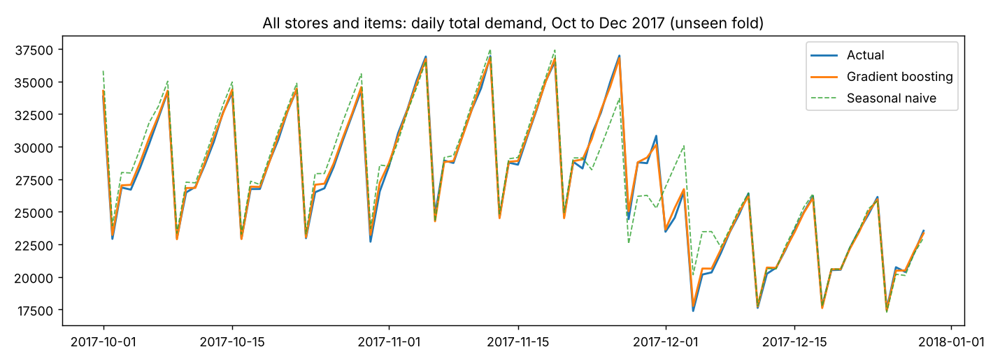
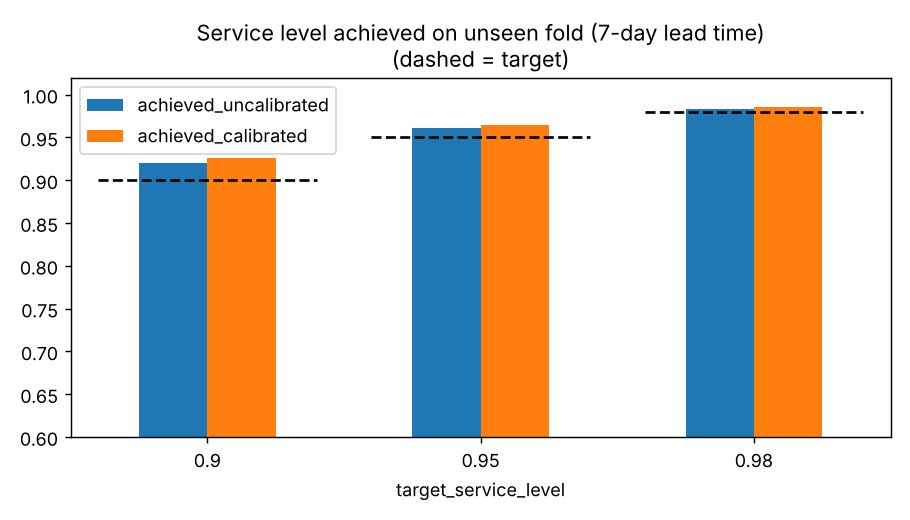

# Retail Demand Forecasting, Stock-out Risk and Inventory Planner

Forecasts daily demand for 10 stores x 50 items for the next 90 days, estimates stock-out risk, and recommends safety stock and reorder points. Built for the **Tredence Analytics brief, Task 1: Retail Demand Forecasting** (forecast demand, calculate stock-out risk, recommend an inventory strategy).

**Live app:** _add your Streamlit link here_

## Objective
Help supply-chain managers decide how much to stock. Audience: supply-chain and category managers. Output: 90-day forecast per store-item, stock-out probability, reorder point, ABC policy.

## Data overview
- `data/train.csv`: Kaggle *Store Item Demand Forecasting Challenge*: 913,000 daily rows, 10 stores x 50 items, 2013-01-01 to 2017-12-31 (`date, store, item, sales`).
- Clean: no missing values or duplicates, every series complete. Average 52 units/day per store-item; items differ about 5x in level.
- Target: forecast 2018-01-01 to 2018-03-31 (saved in `data/forecasts_2018Q1.csv`).

## EDA summary
- Demand grows (about +4 to +8% a year after 2014) with strong **annual seasonality** (July average 67 units vs January 35) and a **weekly cycle** (Sunday 62 vs Monday 41).
- Stores and items differ in level but share the same seasonal shape, so one global model works for all 500 series.

## Approach
1. **Features** (all built from sales at least 90 days old, so the whole 90-day horizon is forecast in one shot with no leakage): calendar, same weekday last year, 4-week weekday average, rolling means, year-on-year growth, seasonal index.
2. **Models:** weekday average, seasonal naive x growth, and gradient boosting (`HistGradientBoostingRegressor`, log target). Optional ARIMA/LSTM comparison in `notebooks/02_arima_lstm_optional.ipynb`.
3. **Validation:** two time-ordered back-tests on unseen quarters (Jul-Sep 2017 and Oct-Dec 2017).
4. **Stock-out risk:** demand over the lead time ~ normal with mean = sum of forecasts and spread from back-test errors. Safety stock = z x spread, reorder point = mean + safety stock.

## Results (average of two back-test folds)
| Model | SMAPE % | MAE | RMSE | WAPE % |
|---|---|---|---|---|
| Weekday average (last 4 weeks) | 22.10 | 13.18 | 16.91 | 22.06 |
| Seasonal naive x YoY growth | 13.84 | 7.45 | 9.67 | 12.21 |
| **Gradient boosting (final)** | **11.69** | **6.22** | **8.08** | **10.19** |

- Total demand (all series summed) is forecast with 0.84% SMAPE on the Oct-Dec 2017 fold, versus 3.58% for seasonal naive.
- Most important feature: last year's same-weekday level, then month and weekday.
- **Stock-out back-test** (calibrated on fold A, tested on unseen fold B, 7-day lead time): targets of 90 / 95 / 98% service gave 92.6 / 96.5 / 98.6% of windows without a stock-out, so the policy meets or slightly exceeds targets (mildly conservative).
- **ABC policy** (A = top 80% of volume at 98% service, B 95%, C 90%): 311 / 123 / 66 store-items; holds about 16% more safety-stock units than a flat 95% rule (20,367 vs 17,537 for a 7-day lead time) but protects the items that make up most of sales. No cost data is available, so service levels are policy inputs.




### ARIMA / LSTM
_Run `notebooks/02_arima_lstm_optional.ipynb` (needs `statsmodels` and `tensorflow`) and paste its comparison table here._

## Limitations
No price, promotion, holiday or weather data; fixed lead time; normal approximation; no holding or stock-out costs.

## Project structure
```
data/            train.csv, forecasts_2018Q1.csv
notebooks/       01_demand_forecasting.ipynb (main), 02_arima_lstm_optional.ipynb
src/             forecasting.py (features, models, stock-out maths), train.py (full pipeline), planner.py (app logic)
models/          hgb_forecaster.joblib
reports/         metrics, comparison tables, calibration, figures
app.py           Streamlit app
```

## Run locally
```bash
pip install -r requirements.txt   # add requirements-optional.txt for notebook 02
python src/train.py        # optional, about 3 minutes: re-runs back-tests and regenerates forecasts/reports
streamlit run app.py
```

## Deploy (Streamlit Community Cloud)
1. Push the repo to GitHub (largest file is `train.csv`, 17 MB).
2. At share.streamlit.io choose **New app**, select the repo, branch `main`, main file `app.py`.
3. Deploy, open the link in a private window to confirm it works, paste it at the top of this README and add screenshots.
